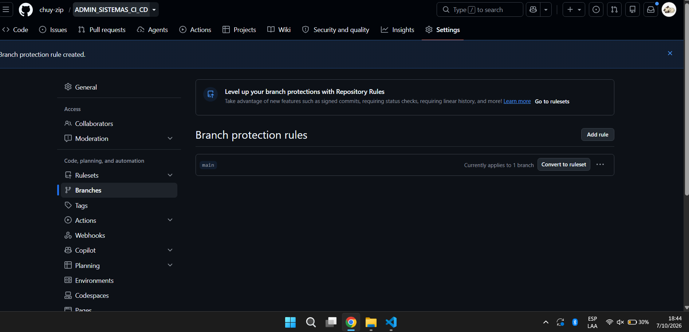
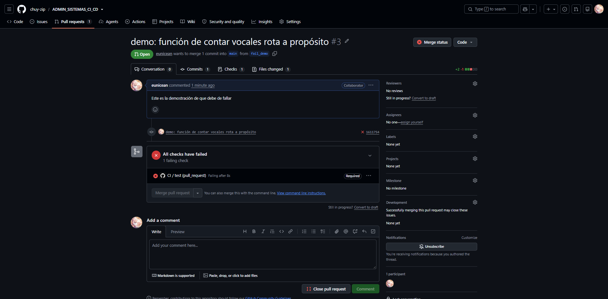
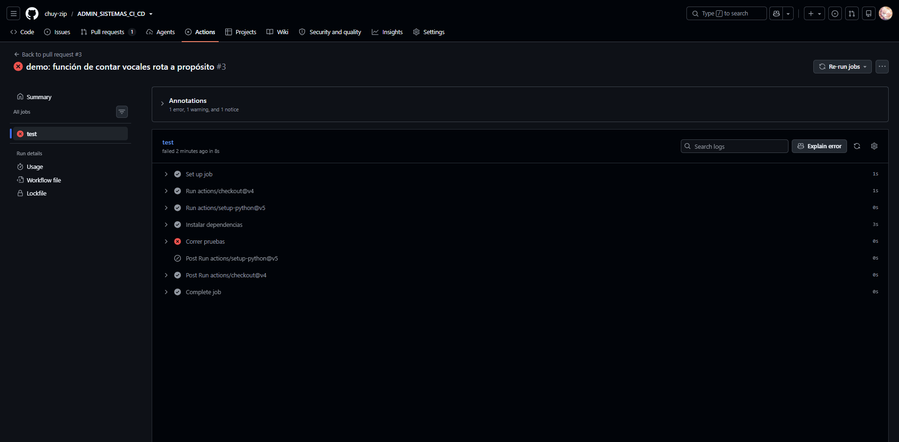
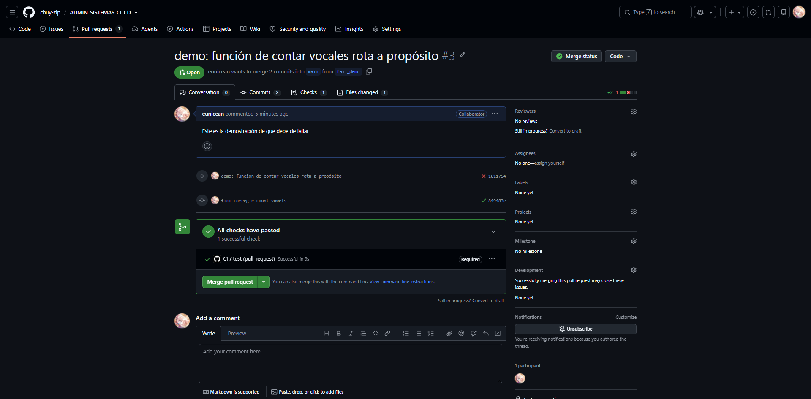

# gh_actions_demo

Sesión Práctica #7 – Continuous Integration (CC3047, UVG).
Librería de manipulación de texto (Opción B) con pruebas unitarias y CI en GitHub Actions.

## Funciones (`manipulacion_texto.py`)

| Función | Descripción |
|---|---|
| `reverse(s)` | Retorna la cadena en orden inverso |
| `count_vowels(s)` | Retorna el total de vocales (incluye acentuadas) |
| `is_palindrome(s)` | Retorna si la cadena es palíndromo (ignora mayúsculas, espacios y signos) |
| `to_upper(s)` | Retorna la cadena en mayúsculas |
| `concat(a, b)` | Retorna la unión de dos cadenas |

Todas lanzan `TypeError` si reciben un valor que no sea `str`.

## Ejecutar las pruebas

```
pip install pytest
python -m pytest -v
```

## Integración continua

El workflow `.github/workflows/ci.yml` corre las pruebas en cada Pull Request hacia `main`.
La rama `main` está protegida: no se puede hacer merge mientras el check `test` no pase.

### Evidencia de la protección de `main`



## Demo: prueba que falla a propósito

Para evidenciar que la validación opera, en la rama `fail_demo` se rompió `count_vowels`
quitándole las vocales acentuadas:

```python
return sum(c in "aeiou" for c in s.lower())
```

Con este cambio fallan los casos que contienen tildes.

### 1. Pull Request con el merge bloqueado

Al abrir el PR #3 (`fail_demo` merge a `main`), el check requerido `CI / test` falla y el botón
**Merge pull request** queda deshabilitado por la regla de protección.



### 2. Detalle del workflow fallido

En GitHub Actions se ve que el paso **Correr pruebas** es el que falla.



### 3. Corrección y merge habilitado

Se restauraron las vocales acentuadas en un nuevo commit (`fix: corregir count_vowels`) sobre la
misma rama. El PR se actualizó solo, el workflow volvió a correr, el check pasó y el merge quedó
habilitado.


